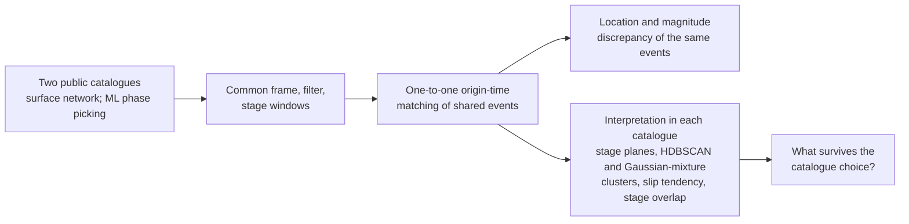

# Catalogue dependence of fracture interpretation — Utah FORGE 2024


Code accompanying the manuscript

> **Same earthquakes, different fractures: how the choice of microseismic catalogue changes fracture interpretation at the 2024 Utah FORGE stimulation** (under review)

The code reproduces every number, table and data figure in the paper from public data: two independently processed microseismic catalogues of the April 2024 stimulation of well 16A(78)-32 at the Utah FORGE enhanced geothermal system. No catalogue data or results are stored in the repository; `run_all.sh` creates them.

## What the code does



* **Matching:** events are paired by origin time only (one-to-one, 0.5 s tolerance), so the location comparison is not biased towards agreement.
* **Discrepancy:** constant offset between frames, event-specific residuals, similarity and affine fits, magnitude regression.
* **Interpretation:** PCA planes per stage with bootstrap cones; HDBSCAN and Dirichlet-process Gaussian-mixture clustering; cross-catalogue agreement (ARI, AMI), swap and perturbation tests; slip tendency and critical pore pressure under a Monte-Carlo FORGE stress state; stage-to-stage overlap.

## Quick start

```bash
git clone https://github.com/minhaz-engg/forge2024-catalogue-dependence.git
cd forge2024-catalogue-dependence
python -m venv .venv && source .venv/bin/activate
pip install -r requirements.txt
# download the two public catalogues into data/raw/ as described in data/README.md
bash run_all.sh            # about 1 min on a laptop; writes data/, results/ and figures/
```

## Repository layout

```
.
├── code/
│   ├── fz.py                 shared functions (frames, stages, PCA planes, orientation statistics, stress)
│   ├── s01_prepare.py        catalogues -> common frame, spatial filter, stage labels
│   ├── s02_match.py          one-to-one origin-time matching
│   ├── s03_discrepancy.py    location and magnitude discrepancy of matched events
│   ├── s04_stage_planes.py   stage planes in each catalogue, bootstrap, cross-catalogue angles
│   ├── s05_clusters.py       HDBSCAN and Gaussian-mixture clustering, swap and perturbation tests
│   ├── s06_stress.py         slip tendency, dilation tendency, critical pore pressure
│   ├── s07_overlap.py        stage-to-stage overlap
│   ├── s08_facts.py          numbers quoted in the text
│   └── make_figures.py       figures
├── data/
│   ├── README.md             where to download the inputs
│   └── stage_times.csv       stage pump-on/shut-in times derived from the public treatment records
├── requirements.txt
└── run_all.sh
```

## Steps and outputs

| Script | Paper | Output in `results/` |
|---|---|---|
| `s01_prepare.py` | Sect. 2 | `stage_counts.csv`; filtered catalogues in `data/` |
| `s02_match.py` | Sect. 3.1, 4.1; Table S1 | `matched_pairs.csv`, `match_by_stage.csv`, `match_tolerance.csv` |
| `s03_discrepancy.py` | Sect. 3.2, 4.2; Table 1 | `discrepancy.json`, `discrepancy_by_stage.csv` |
| `s04_stage_planes.py` | Sect. 3.3, 4.3; Table 2 | `stage_planes.csv`, `stage_plane_comparison.csv` |
| `s05_clusters.py hdb` / `bgmm` | Sect. 3.4, 4.4; Tables S2–S3 | `hdb_*`, `cluster_swap.csv`, `perturbation_ari.csv`, `bgmm_runs.csv` |
| `s06_stress.py` | Sect. 3.5, 4.5; Table 2 | `stress_tendencies.csv`, `stress.json` |
| `s07_overlap.py` | Sect. 3.6, 4.6 | `stage_overlap.csv`, `overlap.json` |
| `s08_facts.py` | numbers in the text | `facts.json` |
| `make_figures.py` | Figs. 1–9, S1, graphical abstract | `figures/` |

## Reproducibility

* `requirements.txt` pins the versions used for the paper (Python 3.10).
* All random steps use fixed seeds.
* The analysis was run independently on two machines: 169 of the 206 reported numbers agree exactly; the remaining 37 come from HDBSCAN, whose cluster boundaries differ for a few events between platforms, and differ by at most 0.005 in adjusted Rand index.

## Data

All inputs are public (see [`data/README.md`](data/README.md)):

* Niemz, P., et al. (2024). *Utah FORGE 2024 stimulations: microseismic event catalog from seismic surface network* [Data set]. Zenodo. https://doi.org/10.5281/zenodo.12817881
* Zhu, W., et al. (2026). *Utah FORGE: Phase-Picking Based Microseismic Event Catalog – April 2024 Stimulation* [Data set]. Geothermal Data Repository. https://gdr.openei.org/submissions/1817
* England, K. (2024). *Utah FORGE: Wells 16A(78)-32 and 16B(78)-32 Stimulation Pressure and Circulation Data April, 2024* [Data set]. Geothermal Data Repository. https://doi.org/10.15121/2371032 (source of `data/stage_times.csv`)

## Licence

Provided for peer review only; see [`LICENSE`](LICENSE). An open-source licence will be added when the paper is published.
